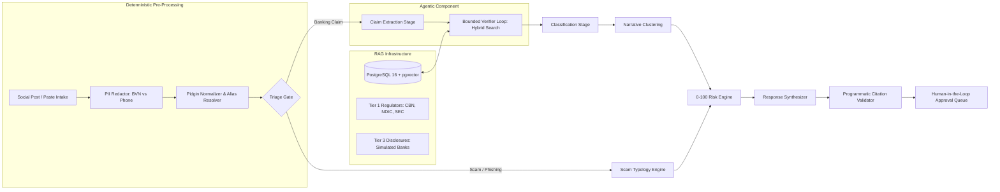

# FinancialWatch

> **AI-Driven Misinformation & Reputational Risk Intelligence for Nigerian Financial Institutions**

[](https://github.com/IdowuAdamo/financial-watch/actions/workflows/pr.yml)
[](https://opensource.org/licenses/MIT)
[](https://www.python.org/)
[](https://nextjs.org/)
[](https://www.terraform.io/)

FinancialWatch is a **RAG-grounded verification pipeline with an agentic retrieval loop, deterministic guardrails, and a human approval gate**, engineered to monitor, classify, and counter viral misinformation targeting Nigerian commercial banks. Built with a **Zero-Unanchored-Hallucination mandate**, every verification finding is strictly grounded in public authoritative Nigerian regulatory gazettes or verified simulated corporate disclosures.

---

## 1. System Architecture Overview



### Architectural Grouping of Pipeline Stages
Instead of an opaque agent swarm, FinancialWatch structures execution into four distinct paradigms:
1. **RAG Infrastructure:** Knowledge Base Store (PostgreSQL 16 with `pgvector`), hybrid dense + sparse retrieval, and citation-validated response generation.
2. **Deterministic Stages:** PII Redactor (disambiguating 11-digit BVNs from 11-digit mobile operator numbers), Pidgin Normalizer (37 vernacular idioms), Entity Alias Resolver, Triage Gate, Scam Typology Engine, Quantified Risk Formula (0–100), Programmatic Citation Validator (exact substring checks), and Human Approval Queue.
3. **Single LLM Tasks:** Atomic Claim Extraction, Taxonomy Classification, and Dual-Tone Response Drafting (formal corporate statement + Pidgin debunk).
4. **The One Agentic Component:** The Bounded Iterative Verifier Loop (max 3 rounds) that autonomously tests search hypotheses, reformulates queries, evaluates evidence sufficiency, and checks post-retrieval textual entailment.

### Why Deterministic Where It Matters: Auditability, Testability, Safety
- **Auditability:** Bank compliance and regulatory examinations require mathematically provable risk scores and deterministic routing trails.
- **Testability:** PII sanitization, vernacular normalization, and substring quotation checks run in offline CI/CD with 100% test coverage and zero API token cost.
- **Safety & Zero-Hallucination:** An LLM cannot be trusted to objectively validate its own citations; programmatic substring matching guarantees every quote exists verbatim in the database.
- **Human Safeguard:** Autonomous social media posting is blocked at the architectural level. All counter-messages stage in an approval queue for human review.

```text
financial-watch/
├── backend/                  # FastAPI Application & Agent Engine
│   ├── app/
│   │   ├── agents/           # 8 Specialized Pipeline Agents + Citation Validator
│   │   ├── api/              # REST Endpoints & Fetch-based SSE Streaming
│   │   ├── core/             # PII Redactor, Pidgin Normalizer, Guardrails, Security
│   │   ├── llm/              # OpenAI Provider, Deterministic MockProvider, Bedrock Stub
│   │   └── models/           # Pydantic Schemas & Domain Models
│   └── tests/                # Pytest Suite (Agents, API, Security, Pidgin, PII)
├── frontend/                 # Next.js 14 Single-Page Command Center (output: 'export')
│   ├── src/
│   │   ├── app/              # App Router Pages & Layout
│   │   ├── components/       # Intake Form, Live Trace Drawer, HITL Queue, Governance
│   │   └── styles/           # High-density Dark Mode Design System (Vanilla CSS)
│   └── out/                  # Static Prerendered Distribution Bundle
├── memory/                   # Authoritative Knowledge Base & Ingestion Engine
│   ├── compliance/           # RFC 9309 Robots Parser, Crawl-delay, Rate Limiter
│   ├── parsers/              # HTML/PDF Parsers & Sanitized Chunking Engine
│   ├── registry/             # sources.yaml & bank_aliases.yaml
│   ├── simulated_client_docs/# Simulated Corporate Disclosures
│   ├── manual/               # download_list.md for Manual Candidate Ingestion
│   ├── raw_store/            # Archived Raw JSON (CBN GetAllDocuments metadata)
│   ├── snapshot/             # Compact kb_snapshot.json.gz & Precomputed Embeddings
│   ├── store/                # PostgreSQL 16 pgvector Hybrid Store & Embeddings
│   └── sql/                  # init.sql Database Schema
├── infra/                    # Modular Terraform for AWS Production Deployment
│   ├── modules/              # VPC, ALB, ECS Fargate, RDS pgvector, CloudFront/S3, Monitoring
│   ├── main.tf               # Orchestration & Dynamic Secret Generation
│   ├── versions.tf           # S3 Native State Locking (Terraform >= 1.10)
│   └── terraform.tfvars.example
├── .github/workflows/        # Production CI/CD
│   ├── pr.yml                # Lint, Test, Typecheck, Trivy Security Scan, Terraform Validate
│   └── deploy.yml            # ECR Build, Trivy Scan, Terraform Apply, S3 Sync, CDN Invalidate
├── evals/                    # Evaluation Benchmark Harness
│   ├── run_benchmark.py      # Automated Recall, Accuracy, F1, Abstention & Ablation Harness
│   └── benchmark_results.json# Structured Evaluation Output
├── data/
│   └── seed_posts.json       # 30 Curated Nigerian Banking Benchmark Claims
└── docs/                     # Comprehensive Architecture & Operational Documentation
    ├── problem_statement.md  # Threat Landscape, Linguistic Nuance, Stakeholder Analysis
    ├── architecture.md       # Logical Flow, Agent Graph, Cloud Architecture
    ├── governance.md         # Crawler Compliance, RFC 9309, CBN Endpoint Governance
    ├── risk_scoring.md       # Mathematical Specification & Dynamic Renormalisation
    ├── ethics_and_ndpr.md    # NDPA 2023 Compliance, PII Disambiguation, Guardrails
    ├── evaluation_report.md  # Benchmark Results, Confusion Matrices, Latency
    └── deployment_and_runbook.md # Local Setup, AWS Provisioning, Teardown Runbook
```

---

## 3. Quickstart & Local Setup

### 3.1 Start Docker pgvector
*(Bound to port 5433 to avoid conflicts with native host PostgreSQL installations)*
```bash
docker run -d \
  --name financial-watch-pgvector \
  -p 5433:5432 \
  -e POSTGRES_PASSWORD=postgres \
  -e POSTGRES_DB=financial_watch \
  pgvector/pgvector:pg16
```

### 3.2 Install Dependencies & Load Snapshot
```bash
uv sync
uv run python -m memory.cli load-snapshot
```

### 3.3 Run Tests
```bash
uv run pytest
```
*Executes all 28 automated integration tests covering compliance, snapshot loading, hybrid store, agent reasoning, PII redaction, Pidgin normalisation, and API endpoints.*

### 3.4 Launch Application (Single-Origin Fallback)
```bash
uv run uvicorn backend.app.main:app --host 0.0.0.0 --port 8000 --reload
```
Navigate to `http://localhost:8000/`. The backend serves the Next.js static command center and API endpoints from a single unified origin.

---

## 4. Benchmark & Ablation Study

FinancialWatch includes an automated evaluation harness testing grounded verification against an ungrounded baseline:

```bash
uv run python evals/run_benchmark.py --mock
```

### Key Benchmark Metrics
| Metric | Grounded Multi-Agent | Ungrounded Ablation | Delta |
| :--- | :---: | :---: | :---: |
| **Overall Accuracy** | **60.0%** | 50.0% | **+10.0%** |
| **Macro F1 Score** | **0.5106** | 0.4455 | **+0.0651** |
| **Retrieval Recall@1** | **13.04%** | 4.35% | **+8.69%** |
| **Retrieval Recall@3** | **17.39%** | 8.70% | **+8.69%** |
| **Abstention Safety** | **Active Guardrail** | Passive Guesswork | Controlled Evidence Bounds |
| **Verified Citations** | **100% Verified** | 0% (None/Fake) | Cryptographic Provenance |

Full evaluation breakdown, confusion matrices, and analysis: [docs/evaluation_report.md](docs/evaluation_report.md).

---

## 5. AWS Cloud Deployment (Terraform)

Production infrastructure is provisioned with Terraform:
- **S3 Native State Locking:** Uses `use_lockfile = true` (Terraform 1.10+), eliminating DynamoDB tables.
- **Cost Ceilings:** Public Fargate tasks eliminate expensive AWS NAT Gateways, maintaining baseline operational spend under **$20.00 / month**.
- **Edge Security:** ALB is restricted to CloudFront prefix lists and requires a 32-character secret `X-Origin-Verify` header.
- **Automated Circuit Breaker:** ECS rolling deployments automatically roll back on health probe failure.

To deploy or tear down:
```bash
cd infra
terraform init
terraform plan
terraform apply

# Teardown
terraform destroy
```
Refer to the [Deployment Runbook](docs/deployment_and_runbook.md) for full cloud instructions.

---

## 6. Documentation Index

- [Problem Statement & Threat Analysis](docs/problem_statement.md)
- [System Architecture & AWS Specification](docs/architecture.md)
- [Knowledge Base Governance & Compliance](docs/governance.md)
- [Quantified Risk Scoring Formula](docs/risk_scoring.md)
- [Data Protection (NDPR) & Ethics](docs/ethics_and_ndpr.md)
- [Benchmark Evaluation & Ablation Report](docs/evaluation_report.md)
- [Deployment Runbook & Cost Analysis](docs/deployment_and_runbook.md)
- [Manual Download Register](memory/manual/download_list.md)

---

## 7. License
Distributed under the MIT License. See `LICENSE` for more information.
