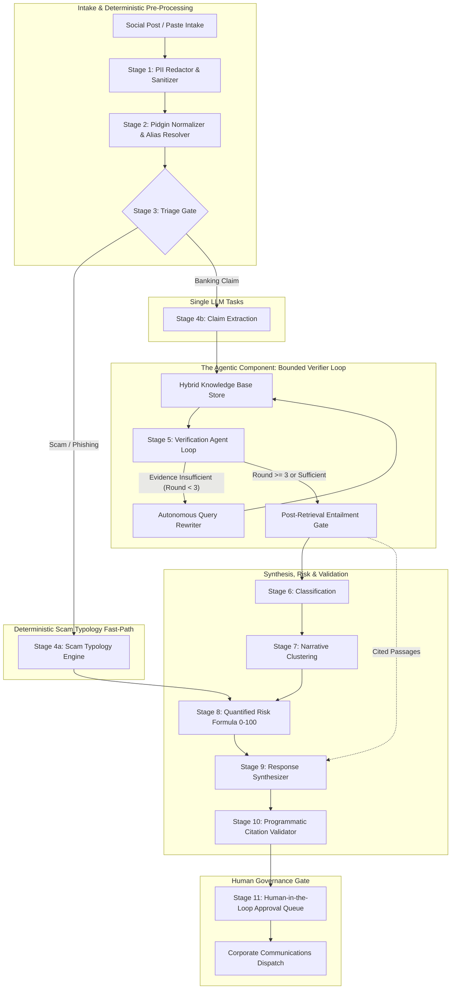

# FinancialWatch: System Architecture & Technical Specification

> **System Definition:** FinancialWatch is a **RAG-grounded verification pipeline with an agentic retrieval loop, deterministic guardrails, and a human approval gate**, engineered for high-stakes financial sector misinformation and reputational risk intelligence.

---

## 1. Architectural Vision & Core Paradigm

FinancialWatch avoids monolithic, non-deterministic "autonomous agent swarms." In financial stability and regulatory compliance, black-box agency introduces unacceptable risks of ungrounded hallucinations, runaway prompt loops, and compliance violations.

Instead, the system is engineered around a **defense-in-depth pipeline** combining:
1. **Deterministic Stages:** Strict rule-based modules for PII sanitization, vernacular normalization, entity alias resolution, fast scam triage, mathematical risk quantification, programmatic citation validation, and human approval queue staging.
2. **RAG Infrastructure:** Authoritative Knowledge Base (official CBN, NDIC, and SEC gazettes + simulated client bank disclosures) with pgvector dense embeddings and full-text search.
3. **Single LLM Tasks:** Targeted, structured zero-shot prompts for atomic claim extraction, taxonomy classification, and dual-tone response drafting.
4. **The One Agentic Component:** A bounded, iterative verifier loop (max 3 rounds) that autonomously evaluates evidence sufficiency, reformulates search hypotheses, checks textual entailment, and enforces strict abstention.

---

## 2. Pipeline Stages Architecture & Workflow



---

## 3. Structural Grouping of Pipeline Components

| Architectural Tier | Pipeline Stages Included | Operational Function | Technology & Execution Model |
| :--- | :--- | :--- | :--- |
| **1. Deterministic Stages** | • **Stage 1: PII Sanitizer**<br>• **Stage 2: Pidgin Normalizer & Alias Resolver**<br>• **Stage 3: Triage Gate**<br>• **Stage 4a: Scam Typology Engine**<br>• **Stage 8: Risk Formula**<br>• **Stage 10: Citation Validator**<br>• **Stage 11: Approval Queue** | Enforces zero-hallucination compliance, regex BVN redaction, heuristic triage, mathematical risk scoring (0–100), substring quotation verification, and mandatory human review. | Python rulebooks, regex tokenizers, morphological dictionaries, and deterministic heuristic scoring. |
| **2. RAG Infrastructure** | • **Authoritative KB Store**<br>• **Hybrid Search (Dense + FTS)**<br>• **Citation-Validated Generation** | Ingests, indexes, and queries official Nigerian regulatory circulars (Tier 1) and simulated client statements (Tier 3). | PostgreSQL 16 + pgvector, `text-embedding-3-small`, `tsvector` sparse search, and compact compressed snapshots. |
| **3. Single LLM Tasks** | • **Stage 4b: Atomic Claim Extraction**<br>• **Stage 6: Taxonomy Classification**<br>• **Stage 9: Dual-Tone Response Drafting** | Performs discrete natural language parsing: extracts verifiable atomic claims, maps findings to risk taxonomy, and synthesizes formal corporate + Pidgin debunk drafts. | Single-turn structured JSON prompts (`gpt-4o-mini` or deterministic MockProvider in offline CI/CD). |
| **4. The One Agentic Component** | • **Stage 5: Bounded Verifier Loop (Max 3 Rounds)** | Autonomously formulates search queries, evaluates whether retrieved passages prove or disprove claims, iteratively rewrites queries on failure, and checks post-retrieval textual entailment. | Multi-turn bounded iterative loop with code-enforced guardrails and fallback abstention. |

---

## 4. Why Deterministic Where It Matters: Auditability, Testability, Safety

In enterprise financial engineering, replacing deterministic algorithms with generative models for safety-critical tasks is an anti-pattern. FinancialWatch enforces determinism across key junctions:

1. **Auditability (Bank Compliance & Legal Defense):**
   - Regulators and compliance officers require repeatable, mathematically provable rationales when assessing risk or issuing public debunks. A deterministic 0–100 risk formula based on explicit severity weights, virality thresholds, and channel tiers provides an immutable audit trail that can be presented in court or to CBN examiners.
2. **Testability & CI/CD Verification:**
   - Deterministic PII redaction (differentiating 11-digit BVNs from 11-digit mobile operator numbers), Pidgin token normalization, and citation substring validation can be tested with 100% test coverage and zero regression in offline CI/CD pipelines without burning LLM API tokens.
3. **Safety & Zero-Unanchored Hallucination:**
   - An LLM prompted to "validate citations" may hallucinate its own compliance. FinancialWatch's `CitationValidator` uses deterministic string parsing to verify that every quoted sentence in a drafted statement is a literal substring of a retrieved, hashed chunk in the database. If verification fails, the draft is rejected before reaching the operator.
4. **Human Approval Safeguard:**
   - Autonomous social media posting by AI agents is architecturally blocked. All system outputs are staged in a human-in-the-loop approval queue where licensed communication officers make the final dispatch decision.

---

## 5. Cloud Deployment Architecture (AWS)

```mermaid
flowchart LR
    User[Client Browser / Operator] --> CF[AWS CloudFront CDN]
    
    subgraph Edge Tier
        CF -- "Static Assets (/*)" --> S3[Amazon S3 Static Bucket]
        CF -- "API & SSE (/api/*, /health)" --> ALB[Application Load Balancer]
    end
    
    subgraph VPC [Dedicated VPC: 10.0.0.0/16]
        subgraph Public Subnets [Public Subnets (No NAT Gateway)]
            ALB -- "Header X-Origin-Verify" --> ECS[Amazon ECS Fargate Backend]
        end
        
        subgraph Private Subnets [Private Isolated Subnets]
            ECS -- "Port 5432 (SSL)" --> RDS[(Amazon RDS PostgreSQL 16 + pgvector)]
        end
    end
    
    subgraph External & Auxiliary
        ECS --> OpenAI[OpenAI API / AWS Bedrock]
        EventBridge[Amazon EventBridge] -- "Scheduled Ingestion (Disabled by Default)" --> ECS
        CloudWatch[Amazon CloudWatch] --- Alerts[AWS Budget $20 & SNS]
    end
```

### Security & Isolation Controls
1. **Dual-Origin CDN Routing:** CloudFront acts as the unified reverse proxy. Static assets are served from private S3 with Origin Access Control (OAC). API requests (`/api/*`, `/health`) route to the Application Load Balancer with caching disabled.
2. **ALB Origin Header Verification:** The ALB enforces a 32-character secret header (`X-Origin-Verify`). Direct internet traffic bypassing CloudFront receives an immediate `HTTP 403 Forbidden`.
3. **Public Fargate Without NAT Gateway:** ECS tasks run in public subnets with public IPs assigned, eliminating the costly AWS NAT Gateway (~$35/month). Inbound traffic is strictly blocked by Security Groups (accepting connections only from the ALB). Outbound traffic has direct internet egress for OpenAI/Bedrock APIs and regulatory crawling.
4. **Isolated Database Subnets:** Amazon RDS PostgreSQL 16 is deployed in isolated private subnets with no internet gateway or public IP routing. Ingress is restricted to port 5432 from the ECS Task Security Group.
5. **Runtime Authentication:** The operator enters an API access key in the UI session, forwarded via `X-API-Key`. The key is never compiled into static frontend bundles.
