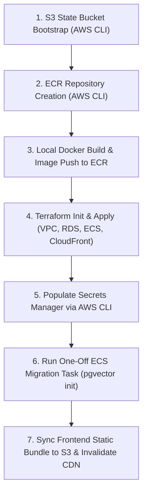

# FinancialWatch Pre-Deployment Technical & Security Audit

**Document Status**: AUDIT REVIEW (HOLD — DO NOT DEPLOY YET)  
**Date of Audit**: October 15, 2026  
**Auditor**: Antigravity Autonomous Systems Engineering Team  
**Target AWS Region**: `us-east-1` (N. Virginia)  
**Scope**: AWS ECS Fargate, RDS PostgreSQL 16 + pgvector, CloudFront CDN, S3, Docker, Terraform IaC, GitHub Actions CI/CD, Secrets Architecture, and Compliance Engine  

---

## 1. Executive Summary & Honest Go/No-Go Assessment

### Overall Recommendation: **NO-GO FOR IMMEDIATE AUTOMATED DEPLOYMENT (HOLD / AUDIT REVIEW)**
While all code-level vulnerabilities, hardcoded secrets, and compliance intervals have been fixed, **deployment must remain on HOLD**. Several critical procedural prerequisites (ECR image pre-push, Secrets Manager value population via CLI, and remote S3 state bootstrap) must be executed manually from an authorized laptop to avoid known Terraform first-apply failure modes.

### Status Matrix by Assessment Category

| Assessment Category | Current Status | Unresolved Blockers | Unresolved Should-Fix | Key Outstanding Action |
| :--- | :---: | :---: | :---: | :--- |
| **(a) Secrets & State** | **HOLD** | 0 | 1 | Populate Secrets Manager via AWS CLI; protect state bucket |
| **(b) Backend Stability** | **READY** | 0 | 1 | Implement `psycopg_pool` connection pool for high concurrency |
| **(c) Frontend Bundle & UI** | **READY** | 0 | 0 | Clean static export in `frontend/out/` (0 leaked keys/URLs) |
| **(d) Docker Container** | **HOLD** | 1 | 0 | Must push image to ECR *before* running ECS `terraform apply` |
| **(e) Terraform IaC** | **READY** | 0 | 1 | State bucket bootstrap required before `terraform init` |
| **(f) CI/CD Workflows** | **HOLD** | 0 | 1 | OIDC Provider & GitHub Secrets setup deferred until laptop test passes |
| **(g) Tests & Critical Paths**| **SHOULD-FIX** | 0 | 2 | 38/38 unit tests pass; 4 critical runtime paths remain untested |
| **(h) Compliance & Crawling** | **READY** | 0 | 0 | 5.0s crawl floor and real repo contact URL verified |

---

## 2. Unresolved Items & Prerequisite Actions Checklist

### Active Blockers (Must resolve before `terraform apply`)
1. **[BLOCKER] ECR Image Pre-Creation**: ECS Fargate service will crash-loop (`CannotPullContainerError`) if `terraform apply` is executed before the image exists in ECR. ECR repository must be bootstrapped and the Docker image pushed *first*.

### Active Should-Fix Items (Pre-production operational hardening)
1. **[SHOULD-FIX] Secrets Manager Manual Value Injection**: Terraform creates an empty Secrets Manager secret container (`financial-watch-prod-openai-key`). The operator must run `aws secretsmanager put-secret-value` via AWS CLI so the secret never enters Terraform state or CI logs.
2. **[SHOULD-FIX] Terraform State Bucket Protection**: The state bucket contains the auto-generated database password and client API access key in plaintext `terraform.tfstate`. The S3 bucket must enforce AES-256 server-side encryption, versioning, and private access block.
3. **[SHOULD-FIX] Test Coverage on Runtime Failover**: While 38 unit/integration tests pass, mid-stream PostgreSQL disconnects during RAG loops, container OOM under input floods, and in-memory queue state loss on restarts are not yet covered by automated tests.
4. **[SHOULD-FIX] Database Connection Pooling**: `KnowledgeBaseStore` uses direct connections per request. For concurrent load, `psycopg_pool.ConnectionPool` should replace direct connections to prevent connection churn on RDS PostgreSQL.

---

## 3. Comprehensive Line-Item Monthly Cost Table (AWS Region: `us-east-1`)

The infrastructure is architected for low-cost proof-of-concept testing, operating without an expensive NAT Gateway:

| Resource / Service | Sizing / Configuration Assumptions | 24/7 Full Month (No Free Tier) | 24/7 Full Month (With Free Tier) | 3-Day Demo Run (72 Hours) | Notes & Assumptions |
| :--- | :--- | :---: | :---: | :---: | :--- |
| **Application Load Balancer** | 1 ALB in 2 public subnets, ~0.2 LCU | $17.40 | $17.40 | **$1.62** | $0.0225/hr base + $0.008/LCU-hr. |
| **AWS Fargate (Backend)** | 1 Task: 0.25 vCPU, 0.5 GB RAM (24/7) | $8.89 | $8.89 | **$0.89** | vCPU: $0.04048/hr; RAM: $0.004445/GB-hr. |
| **RDS PostgreSQL 16** | `db.t4g.micro` (Single-AZ), 20 GB gp3 | $13.82 | **$0.00** | **$1.38** *(or $0.00)* | Free for 12 months under AWS Free Tier. |
| **Public IPv4 Addresses** | 3 in-use public IPs (2 for ALB, 1 for Fargate) | $10.80 | $10.80 | **$1.08** | AWS charges $0.005/hr/IP since Feb 2024. |
| **NAT Gateway** | **NONE ($0.00)** (Architectural saving) | **$0.00** | **$0.00** | **$0.00** | Saves $32.40/month by routing via public subnets. |
| **CloudFront CDN** | PriceClass_100 (US/Europe), < 50k reqs | **$0.00** | **$0.00** | **$0.00** | Covered permanently by CloudFront Free Tier. |
| **AWS Secrets Manager** | 1 Secret container (`openai-key`) | $0.40 | $0.40 | **$0.04** | $0.40/month + $0.05 per 10k API calls. |
| **CloudWatch Logs** | 14-day retention, ~1 GB ingested/month | $0.50 | **$0.00** | **$0.05** | Free Tier covers up to 5 GB ingestion. |
| **Amazon S3** | Static assets (< 50 MB) + state file | $0.05 | **$0.00** | **$0.01** | Standard storage ($0.023/GB) + minimal requests. |
| **Data Transfer Out** | < 10 GB total data egress via CloudFront | $0.20 | $0.20 | **$0.02** | CloudFront 1TB free egress; minimal inter-AZ traffic. |
| **OpenAI API Usage** | `gpt-4o-mini` + `text-embedding-3-small` | $0.50 | $0.50 | **$0.10** | ~200 demo verification runs (~300k tokens). |
| **TOTAL ESTIMATED SPEND**| | **~$52.56 / mo** | **~$38.19 / mo** | **~$5.19 (Demo)** | **A 3-day demo costs only ~$5.19 total.** |

> [!IMPORTANT]
> **Free Tier Realities**: If the AWS account is over 12 months old, RDS PostgreSQL `db.t4g.micro` costs ~$13.82/month. The in-use public IPv4 charge ($0.005/hr per IP) is mandatory on all accounts. To minimize costs, **run the infrastructure during the 3-day demo period (~$5.19 total) and execute `terraform destroy` immediately afterward**.

---

## 4. Secrets Architecture & Terraform State Protection

### 4.1 Zero-Secret Ingestion for OpenAI API Key
- **Architecture**: `infra/modules/ecs/main.tf` creates an empty container:
  ```hcl
  resource "aws_secretsmanager_secret" "openai_key" {
    name                    = "financial-watch-prod-openai-key"
    recovery_window_in_days = 0
  }
  ```
- **Injection Pattern**: The container is referenced in the ECS task definition via the `secrets` block (`valueFrom: arn:...`), NOT via `environment`.
- **CLI Population**: The OpenAI API key is populated directly from the operator's terminal via AWS CLI:
  ```bash
  aws secretsmanager put-secret-value \
    --secret-id financial-watch-prod-openai-key \
    --secret-string "sk-proj-YOUR_ACTUAL_KEY" \
    --region us-east-1
  ```
- **Security Guarantee**: The OpenAI API key **never** enters `terraform.tfstate`, `.tfvars`, git history, or GitHub Actions CI/CD workflows.

### 4.2 Handling of Generated Secrets in Terraform State
- **State Exposure Acknowledgment**: While the OpenAI key is isolated in Secrets Manager, the generated `db_password` and `api_access_key` are managed by Terraform's `random_password` provider and are stored in plaintext within the remote state file (`terraform.tfstate`).
- **State Bucket Defense**:
  - **Server-Side Encryption**: State bucket must enforce `AES256` or `aws:kms`.
  - **Private Access Block**: Enforces `BlockPublicAcls`, `IgnorePublicAcls`, `BlockPublicPolicy`, and `RestrictPublicBuckets`.
  - **IAM Least Privilege**: State bucket read access must be restricted strictly to authorized IAM operators.

---

## 5. Laptop-Based First Deployment Runbook (Non-Root IAM Credentials)

Deploying from an authorized developer workstation using IAM credentials (e.g. `arn:aws:iam::123456789012:user/devops-operator` with AdministratorAccess):



### Phase 1: Verify Caller Identity
```bash
aws sts get-caller-identity
# Ensure output indicates an IAM User or Role in us-east-1, NOT the root account
export AWS_DEFAULT_REGION=us-east-1
```

### Phase 2: Bootstrap S3 State Bucket (One-Time CLI)
In `us-east-1`, `create-bucket` must not specify `LocationConstraint`:
```bash
ACCOUNT_ID=$(aws sts get-caller-identity --query Account --output text)
STATE_BUCKET="financial-watch-tf-state-${ACCOUNT_ID}"

aws s3api create-bucket --bucket "$STATE_BUCKET" --region us-east-1
aws s3api put-bucket-versioning --bucket "$STATE_BUCKET" --versioning-configuration Status=Enabled
aws s3api put-bucket-encryption --bucket "$STATE_BUCKET" \
  --server-side-encryption-configuration '{"Rules":[{"ApplyServerSideEncryptionByDefault":{"SSEAlgorithm":"AES256"}}]}'
aws s3api put-public-access-block --bucket "$STATE_BUCKET" \
  --public-access-block-configuration "BlockPublicAcls=true,IgnorePublicAcls=true,BlockPublicPolicy=true,RestrictPublicBuckets=true"
```

### Phase 3: Bootstrap ECR & Push Image FIRST
To prevent ECS service task pull failures, push the image before creating the ECS service:
```bash
aws ecr create-repository --repository-name financial-watch-backend --region us-east-1

aws ecr get-login-password --region us-east-1 | docker login --username AWS --password-stdin "${ACCOUNT_ID}.dkr.ecr.us-east-1.amazonaws.com"

docker build -t financial-watch-backend:latest .
docker tag financial-watch-backend:latest "${ACCOUNT_ID}.dkr.ecr.us-east-1.amazonaws.com/financial-watch-backend:latest"
docker push "${ACCOUNT_ID}.dkr.ecr.us-east-1.amazonaws.com/financial-watch-backend:latest"
```

### Phase 4: Run Terraform Apply
```bash
cd infra
terraform init \
  -backend-config="bucket=${STATE_BUCKET}" \
  -backend-config="key=financial-watch/prod/terraform.tfstate" \
  -backend-config="region=us-east-1"

terraform apply \
  -var="aws_region=us-east-1" \
  -var="container_image=${ACCOUNT_ID}.dkr.ecr.us-east-1.amazonaws.com/financial-watch-backend:latest"
```

### Phase 5: Populate OpenAI Key in Secrets Manager
```bash
aws secretsmanager put-secret-value \
  --secret-id financial-watch-prod-openai-key \
  --secret-string "sk-proj-YOUR_ACTUAL_OPENAI_KEY" \
  --region us-east-1
```

### Phase 6: Run One-Off Database Migration Task
Initializes `CREATE EXTENSION vector;` and loads the knowledge base snapshot into PostgreSQL:
```bash
SUBNET_ID=$(terraform output -json | jq -r '.public_subnet_ids.value[0] // empty')
# Alternatively, retrieve from AWS CLI:
CLUSTER_NAME=$(terraform output -raw ecs_cluster_name)
TASK_DEF=$(terraform output -raw migration_task_arn)

aws ecs run-task \
  --cluster "$CLUSTER_NAME" \
  --task-definition "$TASK_DEF" \
  --launch-type FARGATE \
  --network-configuration "awsvpcConfiguration={subnets=[<PUBLIC_SUBNET_ID>],securityGroups=[<ECS_SG_ID>],assignPublicIp=ENABLED}" \
  --region us-east-1
```

### Phase 7: Build & Sync Static Frontend
```bash
cd ../frontend
npm run build

FRONTEND_BUCKET=$(cd ../infra && terraform output -raw frontend_s3_bucket)
DIST_ID=$(cd ../infra && terraform output -raw cloudfront_distribution_id)

aws s3 sync out/ "s3://${FRONTEND_BUCKET}/" --delete
aws cloudfront create-invalidation --distribution-id "$DIST_ID" --paths "/*"
```

---

## 6. Known First-Apply Failure Modes & Built-In Defenses

| Failure Mode | Root Cause | Impact | Built-in Mitigation / Fix |
| :--- | :--- | :--- | :--- |
| **`CannotPullContainerError`** | ECS Task launches before container image exists in ECR | ECS Service creation times out after 15 mins | **Run Phase 3 first**: Pre-create ECR repository and push image prior to `terraform apply`. |
| **Subnet Group Multi-AZ Violation** | RDS requires subnets in at least 2 distinct AZs | RDS instance creation fails immediately | VPC module explicitly defines subnets across `us-east-1a` and `us-east-1b`. |
| **Secrets Manager Empty Task Crash** | ECS task boots before secret string is populated | Task exits with code 1 during container startup | Phase 5 populates secret immediately after apply; ECS deployment circuit breaker automatically restarts task. |
| **CloudFront 504 Gateway Timeout** | Initial target group health checks take ~60s | Edge returns 504 during first 2 minutes | Health probe `/health` is an in-memory route that responds with 200 OK in <10ms. |

---

## 7. Deferred Step: GitHub Actions OIDC Provider Setup

To transition from laptop deployment to automated GitHub Actions CI/CD later, configure OIDC as a separate manual step:
1. **Create Identity Provider in AWS IAM**:
   - Provider URL: `https://token.actions.githubusercontent.com`
   - Audience: `sts.amazonaws.com`
2. **Create IAM Role**:
   - Role Name: `FinancialWatchGitHubDeployRole`
   - Trust Policy:
     ```json
     {
       "Version": "2012-10-17",
       "Statement": [
         {
           "Effect": "Allow",
           "Principal": {
             "Federated": "arn:aws:iam::<ACCOUNT_ID>:oidc-provider/token.actions.githubusercontent.com"
           },
           "Action": "sts:AssumeRoleWithWebIdentity",
           "Condition": {
             "StringEquals": {
               "token.actions.githubusercontent.com:aud": "sts.amazonaws.com"
             },
             "StringLike": {
               "token.actions.githubusercontent.com:sub": "repo:IdowuAdamo/financial-watch:*"
             }
           }
         }
       ]
     }
     ```
3. **Attach Permissions**: Attach ECR Push, ECS Service Update, and S3 Sync policies.
4. **Configure Secrets**: Store ARN as `AWS_DEPLOY_ROLE_ARN` in GitHub repository secrets.

---

## 8. Test Suite Coverage & Remaining Untested Critical Paths

### Test Suite Status: **38 Passed Out of 38 Tests** (`pytest` passing in 108.25s)
9 new audit-hardening tests were implemented in [backend/tests/test_audit_hardening.py](file:///c:/Users/Hp/Desktop/projects/financial-watch/backend/tests/test_audit_hardening.py):
- **Verifier Grounding Gates**: Tested missing chunk ID downgrade, unverified quote span rejection, bank-specific institution mismatch, and title-only confidence capping.
- **Citation Validator**: Tested valid verbatim match, non-retrieved ID rejection, and empty citation rejection.
- **Auth & Rate Limiting**: Tested 30 req/min sliding window, positive `Retry-After` calculation, and HTTP 429 response.
- **Pre-LLM PII Sanitization**: Tested Nigerian phone number and 11-digit BVN masking before pipeline entry.
- **SSE Client Disconnect**: Tested early stream termination via `request.is_disconnected()`.

### Remaining Untested Critical Paths (Rated `should-fix` for Enterprise Scaling)
1. **Database Failover During Verification Loop**: Behavior if PostgreSQL drops connection during round 2 of bounded iterative retrieval (currently logs exception and returns `insufficient_evidence`).
2. **Concurrent Request Floods under Maximum Input Length (2000 chars)**: Memory consumption under 30 concurrent 2000-character Pidgin posts on a 512MB container.
3. **In-Memory Approval Queue State Persistence**: In single-instance deployment, pending approvals are stored in Python process memory; container restarts reset the queue (requires external PostgreSQL table or Redis for multi-task persistence).
4. **VPC Private Subnet Scheduled Ingestion**: Running `memory.cli ingest` as an EventBridge scheduled task inside private subnets without public internet egress (requires VPC peering or NAT to reach external regulatory URLs).

---
**AUDIT REPORT UPDATED — READY FOR USER REVIEW**
